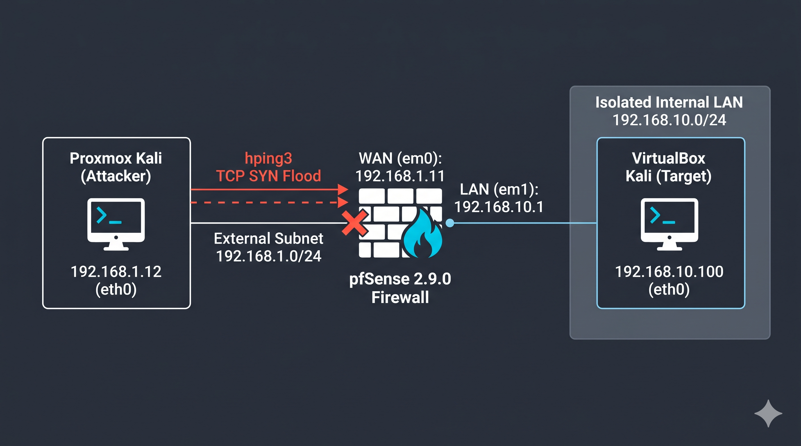
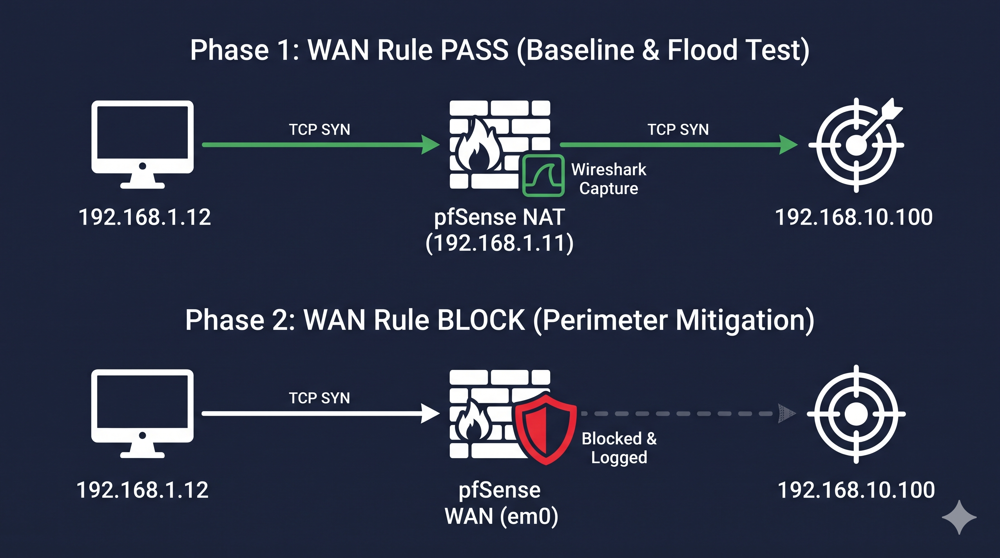
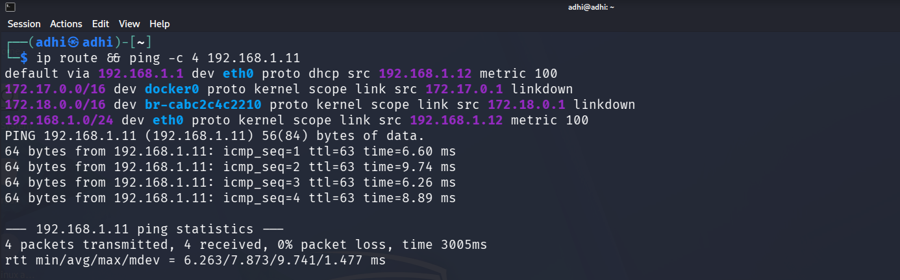
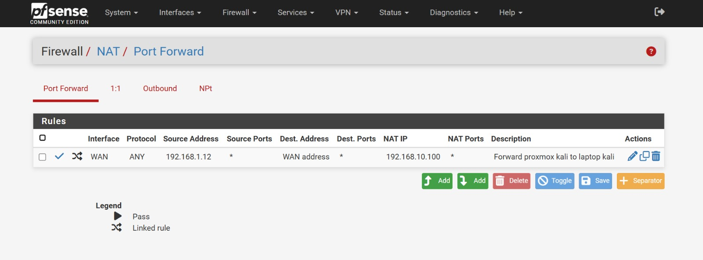
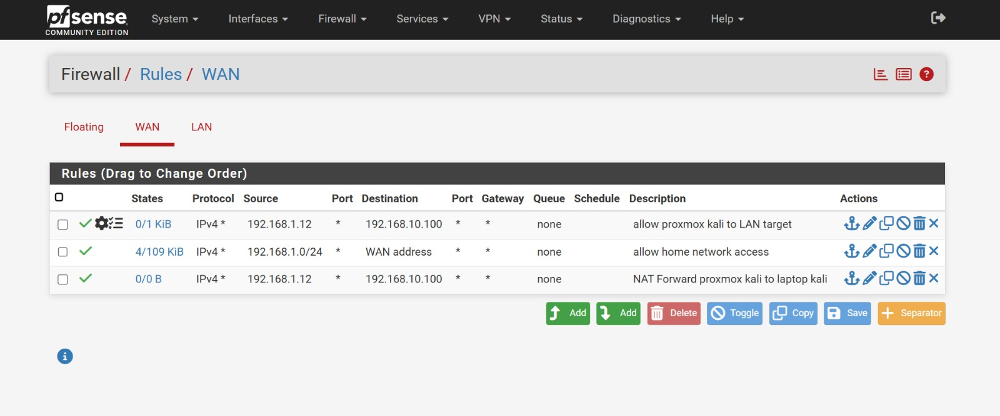
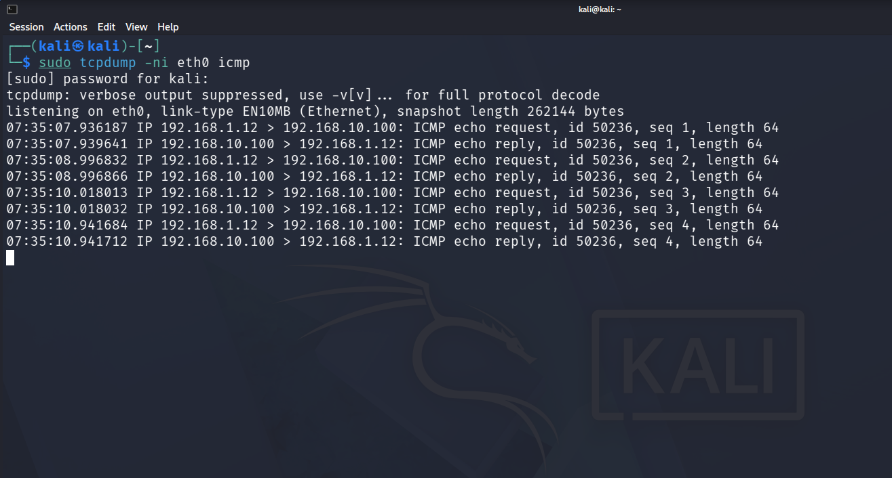
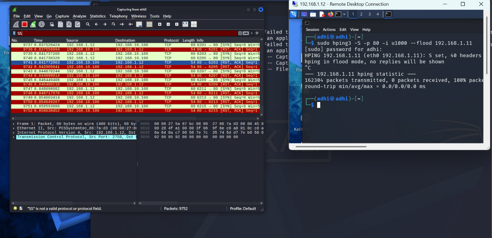
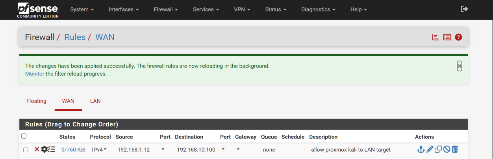
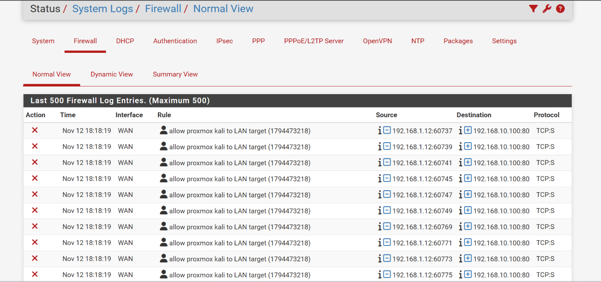

# Segmented Perimeter Firewall & TCP SYN Flood Mitigation Lab

## Overview

A hybrid-hypervisor perimeter defense lab that isolates an internal target behind a **pfSense 2.9.0-RELEASE** firewall. An external TCP SYN flood is simulated with `hping3`, analyzed with `tcpdump` and Wireshark, and then mitigated at the WAN perimeter.

**Skills demonstrated:** network segmentation · static routing · NAT port forwarding · stateful firewall rules · packet analysis · DoS mitigation · firewall log analysis

## Lab Architecture

| Role | Platform | Interface / Network | IP Address |
|---|---|---|---|
| External Attacker | Kali Linux on Proxmox | `eth0`, Bridged `192.168.1.0/24` | `192.168.1.12` |
| Perimeter Firewall (WAN) | pfSense `2.9.0-RELEASE` | `em0`, VirtualBox Bridged `192.168.1.0/24` | `192.168.1.11` |
| Perimeter Firewall (LAN) | pfSense `2.9.0-RELEASE` | `em1`, VirtualBox Internal `intnet` `192.168.10.0/24` | `192.168.10.1` |
| Internal Target | Kali Linux on VirtualBox | `eth0`, Internal `intnet` `192.168.10.0/24` | `192.168.10.100` |





## How I Built & Executed the Lab

### 1. Network Segmentation & Static Routing
Isolated the victim subnet (`192.168.10.0/24`) behind the pfSense LAN (`em1`) and added a static route on the Proxmox attacker:

```bash
sudo ip route add 192.168.10.0/24 via 192.168.1.11
```



### 2. NAT Forwarding & Perimeter Rules
- Disabled RFC 1918 private-network blocking on the WAN.
- Disabled the auto-generated `reply-to` to prevent asymmetric routing drops.
- Configured a WAN NAT Port Forward: `192.168.1.12` → `WAN address` (`192.168.1.11`) → `192.168.10.100`, so traffic can traverse the host Wi-Fi bridge.





### 3. Baseline Connectivity Verification
Verified bidirectional ICMP traffic reaching the internal target:

```bash
sudo tcpdump -ni eth0 icmp
```



### 4. TCP SYN Flood Simulation (`Pass` State)
Launched a controlled TCP SYN flood from the Proxmox Kali attacker and captured the incoming SYN burst in Wireshark on the internal target:

```bash
sudo hping3 -S -p 80 -i u1000 192.168.1.11
```

The screenshot below shows a higher-rate `--flood` run (162,304 packets sent). The target answers with `RST, ACK` because nothing listens on port 80. The raw capture is in [`captures/syn-flood-unmitigated.pcapng`](captures/syn-flood-unmitigated.pcapng).



### 5. Mitigation & Log Telemetry (`Block` State)
Switched the WAN firewall rule from `Pass` to `Block` with logging enabled. No packets leaked into the LAN, and pfSense logged the blocked attempts under **Status > System Logs > Firewall**.





## Key Troubleshooting Takeaways

| Problem | Resolution |
|---|---|
| WAN dropped the attacker's traffic | pfSense blocks RFC 1918 sources on WAN by default; disabled "Block private networks" because the lab WAN is a private `192.168.1.0/24`. |
| Replies lost (asymmetric routing) | Auto-generated `reply-to` sent return traffic the wrong way; disabled it on the WAN rule. |
| Host Wi-Fi bridge dropped frames | Wi-Fi bridging discards frames from unknown MACs; routing through a WAN NAT port forward to the WAN address avoided this. |
| Firewall unresponsive during flood | High-rate `hping3` filled the state table; cleared it with `pfctl -F state` between tests. |

## Repository Layout

```
pfsense-perimeter-firewall-lab/
├── README.md
├── captures/       # Wireshark capture of the unmitigated SYN flood
├── diagrams/       # topology and attack/mitigation flow
└── screenshots/    # numbered lab evidence
```

> **Disclaimer:** All testing was performed in an isolated lab on systems I own.
